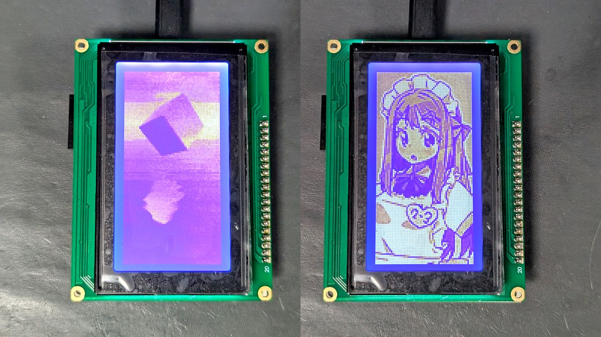
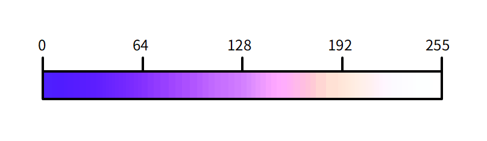
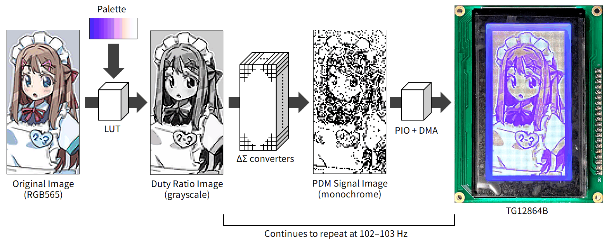
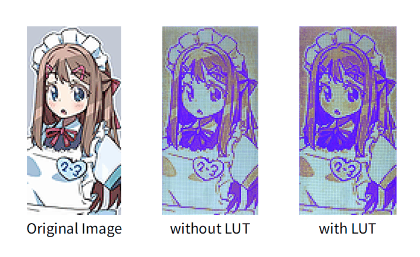

# PDM-FRC: モノクロ液晶 TG12864B で色つき階調表示

Raspberry Pi Pico (RP2040) でモノクロ STN 液晶 TG12864B を 256 階調の色つき階調画像を表示してみました。

## モノクロ液晶 TG12864B

[TG12864B](https://akizukidenshi.com/catalog/g/g104167/) は
秋月通販で 2010 年から売られている 128x64px のバックライト付きモノクロ液晶です。
青背景に白抜きで表示されますが、STN 液晶の特性上応答速度が遅く、紫や黄色の残像が出ます。

この残像を利用すれば、擬似的に 青-紫-黄-白 のトーンから成る画像表示が可能なのでは
ないかということで試してみました。

## Frame Rate Control (Temporal Dithering)

デバイスの本来の階調を超えて中間の階調を表現する手法として
Frame Rate Control (FRC) あるいは Temporal Dithering という手法が知られています。
これは明るい色と暗い色を高速に切り替えることで中間の階調を表現する手法です。
物理的には 8 bit の階調しか対応していないパネルで 10bit の階調を表現するような機能が
モニタや GPU カードなどで利用されています。

今回はこれを応用し、2 階調しか持たない TG12864B で 256 階調の色つき表示を実現します。

## ΔΣ変調 とパルス密度変調 (PDM)

明暗の 2 階調 (ON/OFF) で中間色を表現する手法としてよく用いられるものに PWM がありますが、
PWM で 256 階調を表現しようとすると点滅の周期が 255 フレームになります。
TG12864B がどこまで高いフレームレートで更新できるか分かりませんが、
せいぜい数百フレーム程度でしょうから、255 フレーム周期だと点滅が
はっきりと見えてしまいます。

そこで今回は ΔΣ変調 によるパルス密度変調 (PDM) を用いることにしました。
これなら明暗の周期は液晶の残像で平滑化されて目立たなくなります。

## ディスプレイの発色と最適なフレームレートの確認

パルス密度と発色の対応を確認するため、まず単純なグラデーション画像を表示する
プログラムを作成して動かしてみました。
明暗の周期を目立たなくするには数百 FPS が必要なのではないかと思っていたのですが、
フレームレートを細かく変えながら試したところ、102～103 FPS の間で顕著に
点滅が目立たなくなることに気付きました。

理由は分かりませんが、液晶モジュール内部の何らかの周期的な動作と同期するのではないでしょうか。
102～103 FPS という数字がこの個体だけに当てはまるのか、他の個体でも同様なのかも分かっていませんが、とりあえずこのフレームレートで駆動することにしました。

画面をカメラで撮影し、階調値と見た目の色を対応づけるためのパレットを作成しました。

## 静止画の表示

必要な材料が揃ったので、静止画を表示するプログラムを Raspberry Pi Pico 用に作成しました。

1. パレットを使用して、表示したい色 (RGB565) から階調値を引くための LUT を生成します。
2. LUT を使用して、元画像の色を階調値に変換します。
3. 変換後の階調値をピクセル毎に ΔΣ変調 にかけ、パルス密度に変換し、モノクロ画像を生成します。
4. 生成したモノクロ画像を DMA + PIO で TG12864B に表示します。

3 と 4 を 103 Hz で反復します。
この周波数にジッタが乗ると画面にもノイズが出るので、正確に 103 Hz を維持するようにします。

## LUT の有効性

元画像と、単純にグレースケール化したものを階調値として使った場合と、LUT を使用した画像の比較です。

正直見比べないと分からないくらいの差しか出ませんでした。

LUT なしの場合は肌色が白飛びしてしまいますが、LUT を使った場合は黄色みが強調されます。
輪郭線などは LUT なしの方がジャギが目立たなく見えます。
この傾向は液晶の V0 電圧に関係無く見られました。

TG12864B の場合は LUT の効果は限定的のようです。

## アニメーションの表示

[ShapoGFX](https://github.com/shapoco/shapo-gfx) を使って簡単な 3D シーンをレンダリングして
アニメーション表示するプログラムも作ってみました。
    

64x128px という低解像度ではありますが、レンダリングで 2 倍のオーバーサンプリングしたことと、
発色と残像、PDM によるノイズが相まって何だか「エモい」感じになりました。

もはや保守部品以外の用途の無さそうな古い液晶モジュールですが、
時刻をオーバーレイして時計にしたり、温湿度センサを繋いで値を表示したり、
AI エージェントのステータスを表示したりして、
ちょっとレトロな雰囲気のデスクトップアクセサリとして活用できるかもしれません。

## GitHub リポジトリ

プログラム等は [GitHub リポジトリ](https://github.com/shapoco/pdmfrc) に公開しています。
回路図やビルド済みファームウェアも掲載してますので、部品があればすぐに試すことができます。

